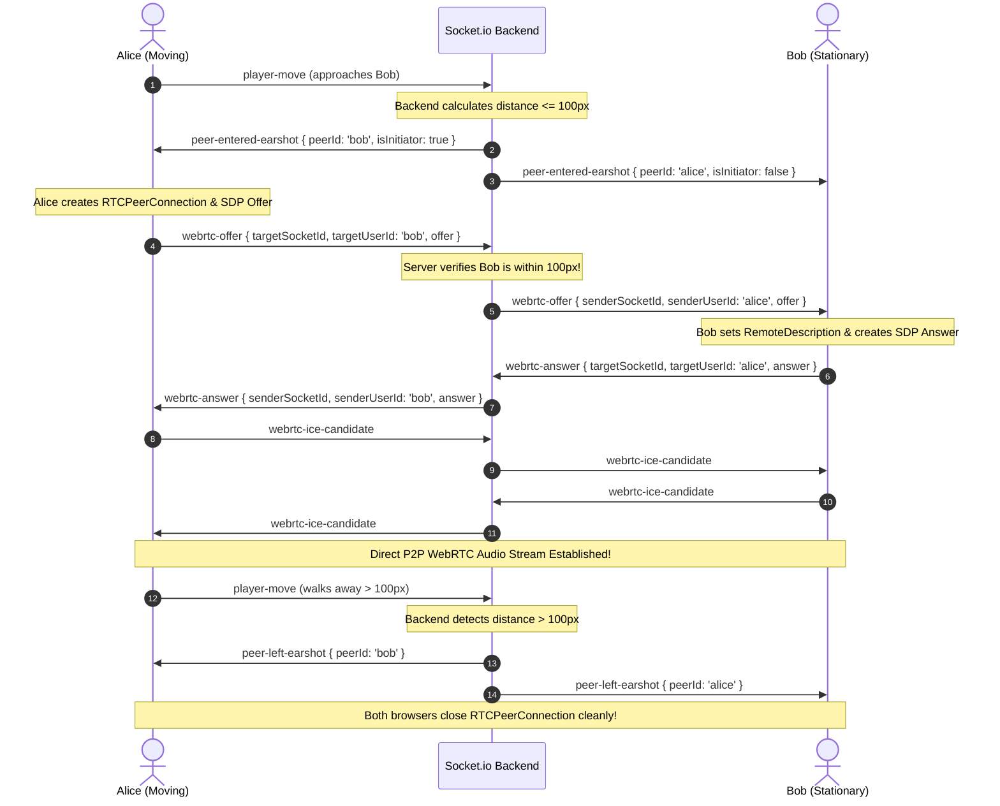

# ProxiSpeak: Geospatial Proximity Audio Ecosystem (Backend & Database Engine)

<a name="team-integration-guide"></a>
## Team Integration Guide

This section is written specifically for team members responsible for **Frontend (React + Canvas)**, **Real-Time WebRTC (P2P Audio)**, and **Spatial Audio (Web Audio API)**.

---

### 1. For Frontend Engineers (React & HTML5 Canvas)

Your responsibility is rendering the virtual office map, handling user input (arrow keys / WASD / mouse clicks), animating avatars at 60 FPS, and sending movement events to the backend.

#### Client Connection & Room Join:
```javascript
import { io } from "socket.io-client";

const socket = io("http://localhost:5000", {
  query: {
    userId: "user_alice",
    username: "Alice",
    avatarColor: "#10B981",
    roomId: "default-office"
  }
});

// 1. Join office room upon component mount
socket.emit("join-room", {
  roomId: "default-office",
  username: "Alice",
  avatarColor: "#10B981",
  x: 300,
  y: 300
});

// 2. Receive initial room layout, obstacles, and peers already present
socket.on("room-state", ({ room, self, peers }) => {
  console.log("Joined room:", room.name);
  console.log("Obstacles to render:", room.obstacles);
  // Store obstacles and peers in your React state / Canvas render loop
});

// 3. Listen for other avatars entering or moving
socket.on("user-joined", (newUser) => {
  // Add new avatar to Canvas render list
});

socket.on("player-moved", ({ userId, x, y }) => {
  // Update target coordinates of the moving avatar for Canvas lerp / interpolation
  updateAvatarPosition(userId, x, y);
});

socket.on("user-left", ({ userId }) => {
  // Remove avatar from Canvas
});
```

#### Emitting Avatar Movement (Throttled):
In your keyboard / joystick event handler:
```javascript
// Throttle movement emits to ~30-60 Hz using requestAnimationFrame or lodash.throttle
function onAvatarMove(newX, newY) {
  socket.emit("player-move", {
    x: newX,
    y: newY,
    roomId: "default-office"
  });
}
```

#### Rendering Acoustic Obstacles on Canvas:
The backend provides room obstacles with shape types:
- `shape === 'line'`: Draw a line from `(coordinates.x1, coordinates.y1)` to `(coordinates.x2, coordinates.y2)` (e.g. glass wall = translucent cyan, drywall = solid gray).
- `shape === 'rectangle'`: Draw a filled rectangle from `x1, y1` to `x2, y2` (e.g. soundproof booth or conference table).

---

### 2. For Real-Time Engineers (WebRTC Signaling & Selective Mesh)

ProxiSpeak uses a **Selective Proximity Mesh**. You do **NOT** connect to all 50 users at once. You only establish a WebRTC P2P connection when an avatar enters your 100-pixel earshot radius!

The backend manages this lifecycle automatically via `peer-entered-earshot` and `peer-left-earshot`.

#### The Complete WebRTC Lifecycle:



#### Client WebRTC Manager Implementation:
```javascript
const peerConnections = new Map(); // peerId -> RTCPeerConnection
let localAudioStream = null;

// 1. Capture microphone stream once on app start
async function initLocalAudio() {
  localAudioStream = await navigator.mediaDevices.getUserMedia({
    audio: {
      echoCancellation: true,
      noiseSuppression: true,
      autoGainControl: true,
    },
    video: false,
  });
}

// 2. Backend notifies that a peer entered the 100px earshot zone
socket.on("peer-entered-earshot", async ({ peerId, peerSocketId, isInitiator }) => {
  if (peerConnections.has(peerId)) return;

  const pc = new RTCPeerConnection({
    iceServers: [{ urls: "stun:stun.l.google.com:19302" }]
  });
  peerConnections.set(peerId, pc);

  // Add our mic tracks to this peer connection
  localAudioStream.getTracks().forEach((track) => pc.addTrack(track, localAudioStream));

  // Stream received: hand off to Spatial Audio Mixer (Web Audio API)
  pc.ontrack = (event) => {
    const remoteAudioStream = event.streams[0];
    window.spatialAudioMixer.attachPeerAudio(peerId, remoteAudioStream);
  };

  // ICE candidates routing through backend signaling
  pc.onicecandidate = (event) => {
    if (event.candidate) {
      socket.emit("webrtc-ice-candidate", {
        targetSocketId: peerSocketId,
        candidate: event.candidate,
      });
    }
  };

  // Glare prevention: only the designated initiator creates the offer
  if (isInitiator) {
    const offer = await pc.createOffer();
    await pc.setLocalDescription(offer);
    socket.emit("webrtc-offer", {
      targetSocketId: peerSocketId,
      targetUserId: peerId,
      offer,
    });
  }
});

// 3. Handle incoming WebRTC Offer
socket.on("webrtc-offer", async ({ senderSocketId, senderUserId, offer }) => {
  let pc = peerConnections.get(senderUserId);
  if (!pc) {
    pc = new RTCPeerConnection({
      iceServers: [{ urls: "stun:stun.l.google.com:19302" }]
    });
    peerConnections.set(senderUserId, pc);
    localAudioStream.getTracks().forEach((track) => pc.addTrack(track, localAudioStream));

    pc.ontrack = (event) => {
      window.spatialAudioMixer.attachPeerAudio(senderUserId, event.streams[0]);
    };

    pc.onicecandidate = (event) => {
      if (event.candidate) {
        socket.emit("webrtc-ice-candidate", {
          targetSocketId: senderSocketId,
          candidate: event.candidate,
        });
      }
    };
  }

  await pc.setRemoteDescription(new RTCSessionDescription(offer));
  const answer = await pc.createAnswer();
  await pc.setLocalDescription(answer);

  socket.emit("webrtc-answer", {
    targetSocketId: senderSocketId,
    targetUserId: senderUserId,
    answer,
  });
});

// 4. Handle incoming WebRTC Answer
socket.on("webrtc-answer", async ({ senderUserId, answer }) => {
  const pc = peerConnections.get(senderUserId);
  if (pc) {
    await pc.setRemoteDescription(new RTCSessionDescription(answer));
  }
});

// 5. Handle ICE Candidates
socket.on("webrtc-ice-candidate", async ({ senderUserId, candidate }) => {
  const pc = peerConnections.get(senderUserId);
  if (pc) {
    await pc.addIceCandidate(new RTCIceCandidate(candidate));
  }
});

// 6. Backend notifies peer left earshot: gracefully teardown peer connection
socket.on("peer-left-earshot", ({ peerId }) => {
  const pc = peerConnections.get(peerId);
  if (pc) {
    pc.close();
    peerConnections.delete(peerId);
  }
  // Remove from Web Audio mixer
  window.spatialAudioMixer.detachPeerAudio(peerId);
});
```

---

### 3. For Spatial Audio Engineers (Web Audio API & Occlusion)

Your responsibility is taking the remote WebRTC audio stream, routing it through an `AudioContext`, and continuously adjusting **Gain (Volume)**, **Stereo Panning (Left/Right Ear)**, and **Obstacle Damping**.

#### Web Audio API Node Graph:
```
[Remote MediaStream] 
        │
        ▼
[MediaStreamAudioSourceNode]
        │
        ▼
[GainNode (Volume Attenuation + Obstacle Damping)]
        │
        ▼
[StereoPannerNode (Left/Right Directional Pan)]
        │
        ▼
[audioContext.destination (Speakers / Headphones)]
```

#### Audio Mixer Class Implementation:
```javascript
class SpatialAudioMixer {
  constructor() {
    this.audioContext = new (window.AudioContext || window.webkitAudioContext)();
    this.peers = new Map(); // peerId -> { source, gainNode, pannerNode }
  }

  /**
   * Called when a WebRTC track arrives for a peer
   */
  attachPeerAudio(peerId, mediaStream) {
    // Resume audio context if suspended by browser autoplay policy
    if (this.audioContext.state === "suspended") {
      this.audioContext.resume();
    }

    if (this.peers.has(peerId)) {
      this.detachPeerAudio(peerId);
    }

    const source = this.audioContext.createMediaStreamSource(mediaStream);
    const gainNode = this.audioContext.createGain();
    const pannerNode = this.audioContext.createStereoPanner();

    // Default initial values
    gainNode.gain.setValueAtTime(1.0, this.audioContext.currentTime);
    pannerNode.pan.setValueAtTime(0.0, this.audioContext.currentTime);

    // Audio Graph Pipeline: Source -> Gain -> StereoPanner -> Destination
    source.connect(gainNode);
    gainNode.connect(pannerNode);
    pannerNode.connect(this.audioContext.destination);

    this.peers.set(peerId, { source, gainNode, pannerNode });
  }

  /**
   * Called continuously whenever the backend emits 'proximity-update'
   * @param {Array} nearbyPeers - Array from backend with { userId, distance, effectiveGain, pan }
   */
  updateSpatialTelemetry(nearbyPeers) {
    const currentTime = this.audioContext.currentTime;

    for (const peerData of nearbyPeers) {
      const peer = this.peers.get(peerData.userId);
      if (!peer) continue;

      // 1. Smoothly ramp volume gain based on distance & obstacle occlusion
      // (Using setTargetAtTime prevents audio clicks/pops)
      peer.gainNode.gain.setTargetAtTime(
        peerData.effectiveGain, // Backend calculated (Distance Gain * Wall Occlusion)
        currentTime,
        0.05 // 50ms time constant for smooth audio crossfade
      );

      // 2. Smoothly ramp stereo pan (-1.0 = hard left, 0.0 = center, +1.0 = hard right)
      peer.pannerNode.pan.setTargetAtTime(
        peerData.pan,
        currentTime,
        0.05
      );
    }
  }

  /**
   * Called when peer leaves earshot
   */
  detachPeerAudio(peerId) {
    const peer = this.peers.get(peerId);
    if (peer) {
      peer.source.disconnect();
      peer.gainNode.disconnect();
      peer.pannerNode.disconnect();
      this.peers.delete(peerId);
    }
  }
}

// Instantiate globally
window.spatialAudioMixer = new SpatialAudioMixer();

// Hook into backend proximity telemetry event
socket.on("proximity-update", ({ nearbyPeers }) => {
  window.spatialAudioMixer.updateSpatialTelemetry(nearbyPeers);
});
```

---