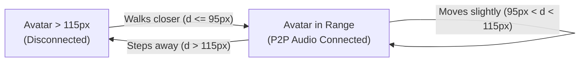
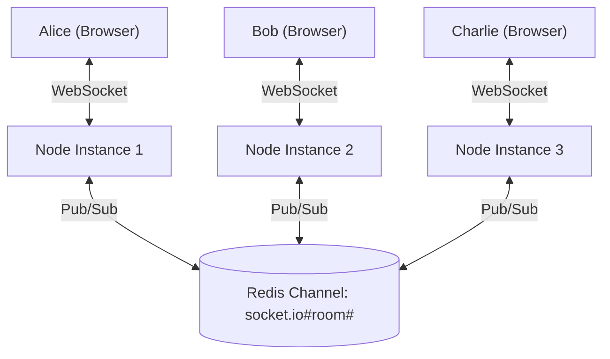

# ProxiSpeak: Scaling & WebRTC Optimization Guide

This document details the architectural blueprints and implementation roadmap for:
1. **Optimizing the WebRTC Mesh Network** (Transitioning from full $O(N^2)$ mesh to an optimized Selective Proximity Mesh).
2. **Horizontal Scaling via Redis Pub/Sub** (Scaling Socket.io across multiple Node.js instances behind a load balancer with sticky sessions and distributed geospatial state).

---

## 1. The Challenge: Scaling to 50+ Concurrent Users

The ProxiSpeak project specification defines a target of **50+ concurrent users in the same virtual office**.

In conventional video conferencing platforms (Zoom, Google Meet), all audio is sent to a central server that mixes or selectively forwards audio. In a pure peer-to-peer (P2P) WebRTC architecture, scaling breaks down exponentially if all users connect to each other simultaneously.

Simultaneously, a single Node.js process runs on a single event-loop thread. As the number of WebSocket connections and movement broadcasts grows, a single instance will bottleneck on CPU.

Below is how ProxiSpeak solves both problems.

---

## 2. Part 1: Optimizing the WebRTC Mesh Network

### The Math of Full Mesh

In a standard Full Mesh WebRTC network, every peer opens a bidirectional P2P connection with every other peer.

$$\text{Total Connections} = \frac{N(N - 1)}{2}$$

For $N = 50$ users:
$$\text{Total Connections} = \frac{50 \times 49}{2} = 1,225\text{ peer connections across the network}$$

Each individual browser client must maintain:
- **$N - 1 = 49$ outgoing upload audio tracks**
- **$N - 1 = 49$ incoming download audio tracks**

At an average Opus audio bitrate of $40\text{ kbps}$:
- **Upload Bandwidth per client:** $49 \times 40\text{ kbps} \approx 1.96\text{ Mbps}$ (unacceptable for residential or mobile uplinks).
- **CPU Overhead:** Encoding and decoding 49 encrypted SRTP audio streams in parallel causes immediate thermal throttling, audio stutter, and browser freezing.

```
Full Mesh (N=50):
Client ───(49 uploads)───> [49 other clients]  ==> CRASH
```

---

### The Selective Proximity Mesh Solution

In ProxiSpeak, users do **not** need to hear everyone in the office. They only hear people within **100 pixels (earshot)**!

Because users naturally cluster into conversation circles of $K$ people (where $K \approx 3 \text{ to } 6$ people):
- Only avatars within $R \le 100\text{px}$ establish WebRTC connections.
- Users outside $100\text{px}$ have **ZERO** WebRTC connections between them.

```
Selective Proximity Mesh (N=50, K=4 in earshot):
Client ───(3 uploads)───> [3 nearby colleagues]  ==> 94% Bandwidth Savings!
```

#### Bandwidth Comparison:
| Metric | Full Mesh ($N=50$) | Selective Proximity Mesh ($K=4$) | Optimization Impact |
| :--- | :--- | :--- | :--- |
| **Connections per Client** | 49 connections | 3 connections | **94% reduction** |
| **Client Upload Bandwidth** | 1,960 kbps (~2 Mbps) | 120 kbps (0.12 Mbps) | **94% bandwidth savings** |
| **Total Connections (50 users)** | 1,225 connections | ~75 - 100 connections | **Over 90% network load reduction** |

The backend enforces this via:
1. `src/sockets/movementHandler.js`: Only fires `peer-entered-earshot` when distance $\le 100\text{px}$.
2. `src/sockets/signalingHandler.js`: Proximity guard intercepts any `webrtc-offer` and rejects it with `OUT_OF_EARSHOT` if the distance is $> 100\text{px}$.

---

### Acoustic Hysteresis & Preventing Boundary Oscillation

#### The "Fence-Hopping" Problem:
If the earshot cutoff is strictly $100.0\text{px}$, an avatar pacing back and forth near the boundary (e.g. moving between $99.5\text{px}$ and $100.5\text{px}$) would cause:
- Rapid `peer-entered-earshot` $\rightarrow$ WebRTC Offer/Answer/ICE $\rightarrow$ Connection opened
- 1 frame later: `peer-left-earshot` $\rightarrow$ Connection closed
- 1 frame later: `peer-entered-earshot` $\rightarrow$ Connection opened again

This "flapping" destroys WebRTC performance and introduces audible clicks.

#### The Dual-Threshold Hysteresis Solution:
Implement two distinct radii:
- **Connect Radius ($R_{\text{connect}}$):** $95\text{px}$ (Peer must get within $95\text{px}$ to establish a connection).
- **Disconnect Radius ($R_{\text{disconnect}}$):** $115\text{px}$ (Peer must move past $115\text{px}$ before connection is terminated).
- **Hysteresis Buffer:** The $20\text{px}$ buffer zone prevents flapping.



---

### Soft Mute vs Hard Teardown

To further optimize connection overhead:
1. **Soft Mute (Between 90px and 120px):**
   - When a peer steps slightly past earshot, do **not** immediately destroy the `RTCPeerConnection`.
   - Set the `GainNode.gain.value = 0` (or disable the `MediaStreamTrack.enabled = false`).
   - Keep the ICE/DTLS connection alive in a standby state for a 5-second grace period.
   - If the user steps back into range, audio unmutes instantaneously with **zero signaling latency**.
2. **Hard Teardown (Past 120px or after 5-second timeout):**
   - If the peer stays outside range for $> 5$ seconds, close the `RTCPeerConnection` (`pc.close()`) to release hardware decoders and memory.

---

### Implementation Roadmap in Code

Here is how you can update `src/sockets/movementHandler.js` to implement dual-threshold hysteresis:

```javascript
// Add dual-threshold configuration
const HYSTERESIS_ENTER_RADIUS = 95;  // px
const HYSTERESIS_EXIT_RADIUS = 115;  // px

function computeHysteresisTransitions(socketId, currentNearbyPeers) {
  const currentSet = socketEarshotMap.get(socketId) || new Set();
  const entered = [];
  const left = [];

  for (const peer of currentNearbyPeers) {
    const isCurrentlyConnected = currentSet.has(peer.userId);

    if (!isCurrentlyConnected && peer.distance <= HYSTERESIS_ENTER_RADIUS) {
      // Connect trigger
      currentSet.add(peer.userId);
      entered.push(peer);
    } else if (isCurrentlyConnected && peer.distance > HYSTERESIS_EXIT_RADIUS) {
      // Disconnect trigger
      currentSet.delete(peer.userId);
      left.push(peer.userId);
    }
  }

  return { entered, left };
}
```

---

### Long-Term Evolution: Selective Mesh vs SFU

| Feature | Selective Proximity Mesh (Current Week 1-4) | SFU (Selective Forwarding Unit, e.g., Mediasoup) |
| :--- | :--- | :--- |
| **Server Bandwidth** | Zero audio bandwidth (audio is pure P2P) | High (audio routes through media server) |
| **Server Cost** | Extremely low (Node.js only handles signaling) | Moderate (requires dedicated media relay servers) |
| **Client Upload** | $K \times 40\text{ kbps}$ ($K \approx 3-5$ peers) | $1 \times 40\text{ kbps}$ (Only 1 upload stream to server!) |
| **NAT Traversal** | Requires STUN/TURN for strict symmetric NATs | Guaranteed relay via SFU server IP |
| **Max Cluster Size** | Comfortable up to 6–8 people in a single circle | Scalable to 50+ people in the exact same circle |

**Recommendation:** Selective Proximity Mesh is the ideal, zero-infrastructure-cost architecture for Week 1–4. If future requirements call for a 30-person townhall meeting in a single conference room, integrate **Mediasoup** or **LiveKit** as a backend media router.

---

## 3. Part 2: Redis Pub/Sub Horizontal Socket.io Scaling

### Single-Node Limitation

By default, Socket.io stores all connected socket IDs and room maps in the memory of the single Node process:
- When Node process 1 runs on CPU Core 1, and Node process 2 runs on CPU Core 2:
- If Alice is connected to Process 1 and Bob is connected to Process 2:
  `io.to("default-office").emit("player-moved", ...)` on Process 1 will **never reach Bob** on Process 2!

```
[Alice on Node 1] ──X──> (No communication) <──X── [Bob on Node 2]
```

---

### Socket.io Redis Adapter Architecture

The `@socket.io/redis-adapter` replaces the internal memory room store with Redis Pub/Sub:
1. When Alice on Node 1 emits an event targeting room `"default-office"`:
2. Node 1 publishes the event to Redis channel `socket.io#default-office#`.
3. Node 2 and Node 3 (which are subscribed to that Redis channel) receive the payload.
4. Node 2 broadcasts the event to its locally connected sockets (including Bob).



---

### Enabling Redis in ProxiSpeak

ProxiSpeak has native, built-in support for Redis clustering in `src/config/redis.js`.

#### Step 1: Update `.env`
```env
REDIS_ENABLED=true
REDIS_HOST=127.0.0.1
REDIS_PORT=6379
REDIS_PASSWORD=
```

#### Step 2: Code Mechanism (`src/config/redis.js`)
```javascript
const { createClient } = require('redis');
const { createAdapter } = require('@socket.io/redis-adapter');

async function setupRedisAdapter(io) {
  if (!config.redis.enabled) return false;

  const pubClient = createClient({ url: `redis://${config.redis.host}:${config.redis.port}` });
  const subClient = pubClient.duplicate();

  await Promise.all([pubClient.connect(), subClient.connect()]);
  io.adapter(createAdapter(pubClient, subClient));
  return true;
}
```
When `REDIS_ENABLED=true`, ProxiSpeak automatically attaches this adapter during `initializeSocketServer()`.

---

### Distributed Spatial State: Redis Hashes & Redis Geo

In a single-instance setup, `activeRoomSpatialState` is an in-memory JavaScript `Map`. In a multi-instance cluster, spatial state must be globally queryable.

#### 1. Redis Hashes for User Presence
Store each user's state in a Redis Hash:
```
HSET proxispeak:room:default-office:users user_alice '{"socketId":"sock1","x":250,"y":250,"username":"Alice"}'
```

#### 2. Redis Geospatial Index (`GEOADD` & `GEOSEARCH`)
Redis provides native geospatial commands that operate in sub-millisecond in-memory speeds:

```bash
# Add avatar coordinates to room spatial index
GEOADD proxispeak:room:default-office:geo 250 250 user_alice
GEOADD proxispeak:room:default-office:geo 280 250 user_bob

# Find all users within 100 meters/pixels of Alice (250, 250)
GEOSEARCH proxispeak:room:default-office:geo FROMLONLAT 250 250 BYRADIUS 100 M WITHDIST WITHCOORD
```

#### Node.js Implementation Snippet:
```javascript
// Adding position to Redis Geo
await redisClient.geoAdd('room:default-office:geo', {
  member: userId,
  longitude: x, // Redis treats longitude as X
  latitude: y,  // Redis treats latitude as Y
});

// Querying nearby users across all instances in < 1ms
const nearby = await redisClient.geoSearch(
  'room:default-office:geo',
  { longitude: x, latitude: y },
  { radius: 100, unit: 'm' },
  ['WITHDIST', 'WITHCOORD']
);
```

---

### Production Nginx Reverse Proxy & Sticky Sessions

Socket.io initially connects via HTTP long-polling and upgrades to WebSocket. Because HTTP long-polling involves multiple requests, **all requests from a given client must hit the same Node instance** (Session Affinity / Sticky Sessions).

#### `nginx.conf`:
```nginx
upstream proxispeak_nodes {
    # ip_hash ensures sticky sessions based on client IP
    ip_hash;

    server 127.0.0.1:5001;
    server 127.0.0.1:5002;
    server 127.0.0.1:5003;
}

server {
    listen 80;
    server_name office.proxispeak.local;

    location / {
        proxy_pass http://proxispeak_nodes;
        proxy_http_version 1.1;

        # WebSocket Upgrade Headers
        proxy_set_header Upgrade $http_upgrade;
        proxy_set_header Connection "upgrade";

        proxy_set_header Host $host;
        proxy_set_header X-Real-IP $remote_addr;
        proxy_set_header X-Forwarded-For $proxy_add_x_forwarded_for;
        proxy_set_header X-Forwarded-Proto $scheme;

        # Timeout settings for long-lived WebSocket connections
        proxy_read_timeout 86400s;
        proxy_send_timeout 86400s;
    }
}
```

---
### Complete Multi-Instance Docker Compose Setup

To launch a production-grade 3-node ProxiSpeak cluster with Redis, MongoDB, and Nginx:

`docker-compose.yml`:
```yaml
version: '3.8'

services:
  mongodb:
    image: mongo:8.0
    restart: always
    volumes:
      - mongo_data:/data/db
    ports:
      - "27017:27017"

  redis:
    image: redis:7-alpine
    restart: always
    ports:
      - "6379:6379"

  node1:
    build: .
    restart: always
    environment:
      - PORT=5001
      - MONGODB_URI=mongodb://mongodb:27017/proxispeak
      - REDIS_ENABLED=true
      - REDIS_HOST=redis
      - REDIS_PORT=6379
    depends_on:
      - mongodb
      - redis

  node2:
    build: .
    restart: always
    environment:
      - PORT=5002
      - MONGODB_URI=mongodb://mongodb:27017/proxispeak
      - REDIS_ENABLED=true
      - REDIS_HOST=redis
      - REDIS_PORT=6379
    depends_on:
      - mongodb
      - redis

  node3:
    build: .
    restart: always
    environment:
      - PORT=5003
      - MONGODB_URI=mongodb://mongodb:27017/proxispeak
      - REDIS_ENABLED=true
      - REDIS_HOST=redis
      - REDIS_PORT=6379
    depends_on:
      - mongodb
      - redis

  nginx:
    image: nginx:alpine
    restart: always
    ports:
      - "80:80"
    volumes:
      - ./nginx.conf:/etc/nginx/conf.d/default.conf:ro
    depends_on:
      - node1
      - node2
      - node3

volumes:
  mongo_data:
```

---

## 4. Verification & Load Testing Plan

When running the cluster:

1. **Verify Redis Inter-Node Pub/Sub:**
   - Connect Client A to `http://localhost:5001`.
   - Connect Client B to `http://localhost:5002`.
   - Move Client A (`player-move`).
   - Verify that Client B receives `player-moved` seamlessly through the Redis adapter.
2. **Verify Proximity WebRTC Routing Across Instances:**
   - Move Client A within 100px of Client B.
   - Verify both clients receive `peer-entered-earshot`.
   - Send `webrtc-offer` from Client A on Node 1; verify Client B on Node 2 receives the offer and sends back `webrtc-answer`.
3. **Execute Latency Audit Across Cluster:**
   - Run `npm run audit` or `GET /api/spatial/audit`.
   - Verify that P95 spatial query latency remains strictly under 20ms under heavy simulated load.
