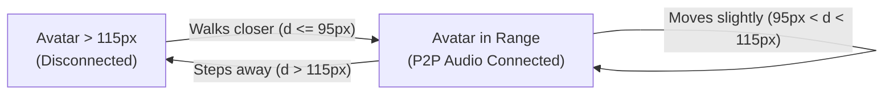

# ProxiSpeak: Scaling & WebRTC Optimization Guide

This document details the architectural blueprints and implementation roadmap for:
1. **Optimizing the WebRTC Mesh Network** (Transitioning from full $O(N^2)$ mesh to an optimized Selective Proximity Mesh).
2. **Horizontal Scaling via Redis Pub/Sub** (Scaling Socket.io across multiple Node.js instances behind a load balancer with sticky sessions and distributed geospatial state).

---

## 1. The Challenge: Scaling to 50+ Concurrent Users

The ProxiSpeak project specification defines a target of **50+ concurrent users in the same virtual office**.

In conventional video conferencing platforms (Zoom, Google Meet), all audio is sent to a central server that mixes or selectively forwards audio. In a pure peer-to-peer (P2P) WebRTC architecture, scaling breaks down exponentially if all users connect to each other simultaneously.

Simultaneously, a single Node.js process runs on a single event-loop thread. As the number of WebSocket connections and movement broadcasts grows, a single instance will bottleneck on CPU.

Below is how ProxiSpeak solves both problems.

---

## 2. Part 1: Optimizing the WebRTC Mesh Network

### The Math of Full Mesh

In a standard Full Mesh WebRTC network, every peer opens a bidirectional P2P connection with every other peer.

$$\text{Total Connections} = \frac{N(N - 1)}{2}$$

For $N = 50$ users:
$$\text{Total Connections} = \frac{50 \times 49}{2} = 1,225\text{ peer connections across the network}$$

Each individual browser client must maintain:
- **$N - 1 = 49$ outgoing upload audio tracks**
- **$N - 1 = 49$ incoming download audio tracks**

At an average Opus audio bitrate of $40\text{ kbps}$:
- **Upload Bandwidth per client:** $49 \times 40\text{ kbps} \approx 1.96\text{ Mbps}$ (unacceptable for residential or mobile uplinks).
- **CPU Overhead:** Encoding and decoding 49 encrypted SRTP audio streams in parallel causes immediate thermal throttling, audio stutter, and browser freezing.

```
Full Mesh (N=50):
Client ───(49 uploads)───> [49 other clients]  ==> CRASH
```

---

### The Selective Proximity Mesh Solution

In ProxiSpeak, users do **not** need to hear everyone in the office. They only hear people within **100 pixels (earshot)**!

Because users naturally cluster into conversation circles of $K$ people (where $K \approx 3 \text{ to } 6$ people):
- Only avatars within $R \le 100\text{px}$ establish WebRTC connections.
- Users outside $100\text{px}$ have **ZERO** WebRTC connections between them.

```
Selective Proximity Mesh (N=50, K=4 in earshot):
Client ───(3 uploads)───> [3 nearby colleagues]  ==> 94% Bandwidth Savings!
```

#### Bandwidth Comparison:
| Metric | Full Mesh ($N=50$) | Selective Proximity Mesh ($K=4$) | Optimization Impact |
| :--- | :--- | :--- | :--- |
| **Connections per Client** | 49 connections | 3 connections | **94% reduction** |
| **Client Upload Bandwidth** | 1,960 kbps (~2 Mbps) | 120 kbps (0.12 Mbps) | **94% bandwidth savings** |
| **Total Connections (50 users)** | 1,225 connections | ~75 - 100 connections | **Over 90% network load reduction** |

The backend enforces this via:
1. `src/sockets/movementHandler.js`: Only fires `peer-entered-earshot` when distance $\le 100\text{px}$.
2. `src/sockets/signalingHandler.js`: Proximity guard intercepts any `webrtc-offer` and rejects it with `OUT_OF_EARSHOT` if the distance is $> 100\text{px}$.

---

### Acoustic Hysteresis & Preventing Boundary Oscillation

#### The "Fence-Hopping" Problem:
If the earshot cutoff is strictly $100.0\text{px}$, an avatar pacing back and forth near the boundary (e.g. moving between $99.5\text{px}$ and $100.5\text{px}$) would cause:
- Rapid `peer-entered-earshot` $\rightarrow$ WebRTC Offer/Answer/ICE $\rightarrow$ Connection opened
- 1 frame later: `peer-left-earshot` $\rightarrow$ Connection closed
- 1 frame later: `peer-entered-earshot` $\rightarrow$ Connection opened again

This "flapping" destroys WebRTC performance and introduces audible clicks.

#### The Dual-Threshold Hysteresis Solution:
Implement two distinct radii:
- **Connect Radius ($R_{\text{connect}}$):** $95\text{px}$ (Peer must get within $95\text{px}$ to establish a connection).
- **Disconnect Radius ($R_{\text{disconnect}}$):** $115\text{px}$ (Peer must move past $115\text{px}$ before connection is terminated).
- **Hysteresis Buffer:** The $20\text{px}$ buffer zone prevents flapping.



---

### Soft Mute vs Hard Teardown

To further optimize connection overhead:
1. **Soft Mute (Between 90px and 120px):**
   - When a peer steps slightly past earshot, do **not** immediately destroy the `RTCPeerConnection`.
   - Set the `GainNode.gain.value = 0` (or disable the `MediaStreamTrack.enabled = false`).
   - Keep the ICE/DTLS connection alive in a standby state for a 5-second grace period.
   - If the user steps back into range, audio unmutes instantaneously with **zero signaling latency**.
2. **Hard Teardown (Past 120px or after 5-second timeout):**
   - If the peer stays outside range for $> 5$ seconds, close the `RTCPeerConnection` (`pc.close()`) to release hardware decoders and memory.

---